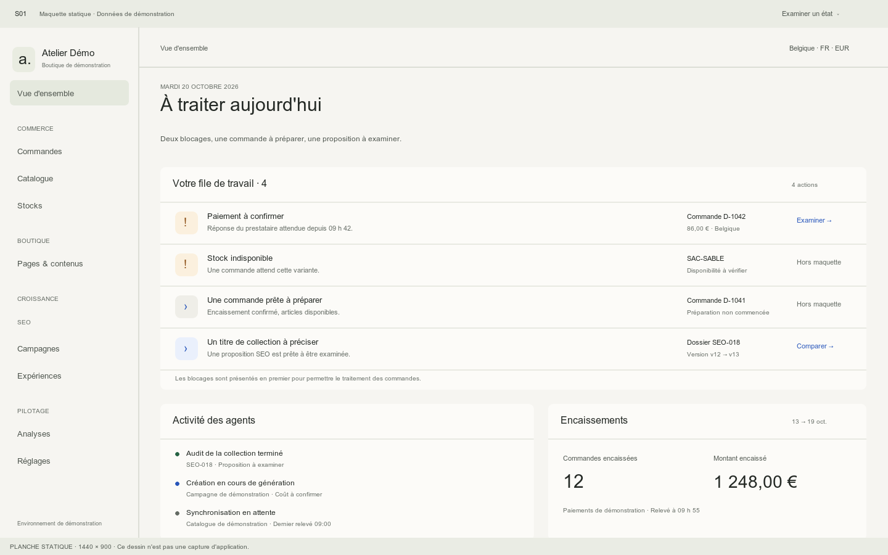
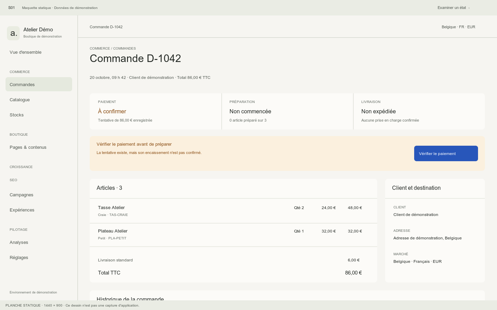
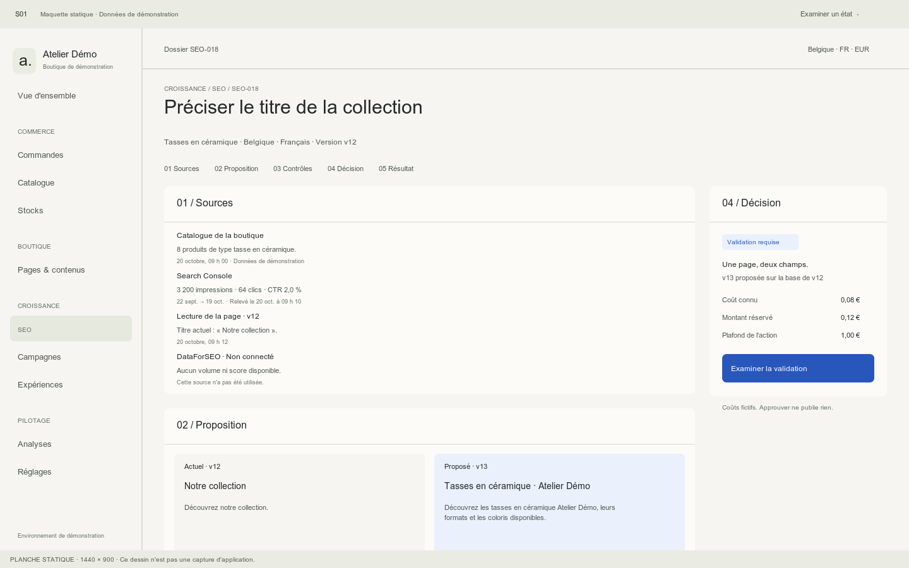

# Planches de conception S01

Ces planches ont été dessinées en SVG puis converties en PNG. Elles sont des maquettes statiques, pas des captures du prototype. Les vues aux dimensions du projet montrent le premier écran ; le contenu continue sous la limite basse. La comparaison SEO mobile dispose d'une planche complémentaire.

Le [prototype local](http://127.0.0.1:5102/) présente les interactions et les autres états. Il doit encore être examiné dans un navigateur autorisé et dans Responsively.

## Vue d'ensemble

## Commande

## Dossier SEO

## Formats disponibles

| Écran | Ordinateur 1440 × 900 | Tablette 1024 × 768 | Mobile 390 × 844 | Mobile étroit 360 × 800 |
|---|---|---|---|---|
| Vue d'ensemble | [PNG](planches/vue-ensemble-ordinateur.png) | [PNG](planches/vue-ensemble-tablette.png) | [PNG](planches/vue-ensemble-mobile.png) | [PNG](planches/vue-ensemble-mobile-etroit.png) |
| Commande | [PNG](planches/commande-ordinateur.png) | [PNG](planches/commande-tablette.png) | [PNG](planches/commande-mobile.png) | [PNG](planches/commande-mobile-etroit.png) |
| Dossier SEO | [PNG](planches/seo-ordinateur.png) | [PNG](planches/seo-tablette.png) | [PNG](planches/seo-mobile.png) | [PNG](planches/seo-mobile-etroit.png) |

[Comparaison SEO mobile, planche de détail 390 × 1000](planches/seo-comparaison-mobile.png).

Chaque PNG possède un SVG de même nom, modifiable sans outil propriétaire. Le [script de génération](planches/generer.py) lit les couleurs dans le CSS du prototype ; ses dispositions restent des dessins de conception séparés. Modifier le HTML ne met donc pas automatiquement les planches à jour.
