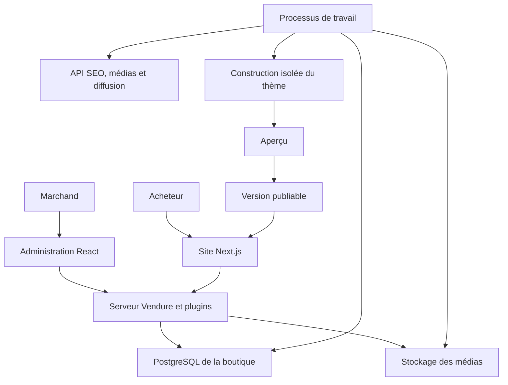
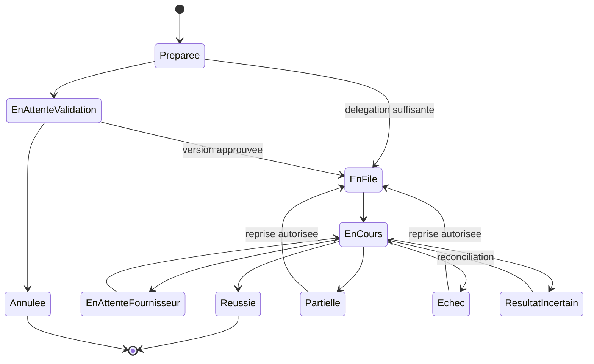

# Architecture de la plateforme e-commerce

Choix du socle et plan technique du premier jalon, le 20 octobre 2026.

Le [cahier produit](CAHIER_PRODUIT.md) définit le périmètre validé. Ce document fixe la recommandation technique et les vérifications à effectuer avant de la considérer comme éprouvée. Les termes métier sont définis dans le [glossaire](GLOSSARY.md) ; les écrans sont décrits dans les [parcours d'interface](PARCOURS_INTERFACE.md).

## 1. Choix recommandé

Retenir **Vendure Community** comme moteur commercial, étendre son administration React et utiliser **Next.js** pour le site de vente. Développer les capacités propres au produit sous forme de modules et de plugins, avec un serveur applicatif et des processus de travail séparés.

Ce choix repose sur les besoins de permissions, de personnalisation de l'administration et d'intégration des agents. Il remplace la candidature initiale de Medusa. La documentation et les sources ont été complétées par une [validation locale de Vendure 3.8.0](../../experiments/core-validation/README.md) sur SQLite et PostgreSQL.

Les premiers parcours API passent avec la protection du stock ajoutée. Le scénario sans cette protection accepte deux achats concurrents pour une unité. Ce résultat conditionne la conception du paiement ; il ne permet pas de considérer tous les moyens de paiement comme validés. Les extensions graphiques et les politiques d'autorisation complètes restent à éprouver.

## 2. Comparaison des moteurs

Les appréciations ci-dessous sont celles du projet. Elles ne sont ni un classement universel ni un benchmark de performance.

| Critère | Medusa | Vendure Community | Saleor |
|---|---|---|---|
| Moteur et API | TypeScript, modules et API REST | TypeScript, NestJS, API GraphQL | Python, API GraphQL |
| Licence du cœur | MIT, avec des matériaux Enterprise identifiés séparément | GPLv3, avec exception documentée pour certains plugins | BSD 3 clauses |
| Permissions d'équipe | Le RBAC proposé actuellement par l'éditeur relève des matériaux Enterprise | Rôles, permissions et périmètre par canal dans les sources ouvertes | Permissions d'administration et d'applications ; accès aux commandes par canal |
| Administration | Administration extensible ; frontière Enterprise à respecter | Administration React avec routes, blocs, navigation et thème extensibles | Administration React et applications communiquant par API et webhooks |
| Marchés et canaux | Briques commerciales disponibles ; multitenancy à construire | Canaux pour prix, langues, stocks et périmètres commerciaux | Canaux pour marchés, prix, disponibilité et paramètres commerciaux |
| Conséquence pour notre produit | Nécessiterait un travail propre sur les permissions et la vérification de leur couverture | Meilleur point de départ retenu pour réunir commerce et modules propres | Option crédible, avec un moteur Python en plus de la couche d'interface et des intégrations TypeScript |

Sources : [Medusa](https://github.com/medusajs/medusa), [périmètre Enterprise](https://github.com/medusajs/medusa/blob/develop/ENTERPRISE-LICENSE.md), [Vendure](https://github.com/vendurehq/vendure), [Saleor](https://github.com/saleor/saleor), [canaux Saleor](https://docs.saleor.io/developer/channels/overview) et [applications Saleor](https://docs.saleor.io/developer/extending/apps/overview).

Les rôles de Vendure peuvent être associés à des canaux, et les plugins peuvent définir leurs permissions. Les permissions natives restent organisées par domaines ; elles ne suffisent pas à exprimer seules toutes nos règles de montant, d'approbation et de budget. Ces règles seront ajoutées côté serveur et vérifiées aussi sur les mutations existantes. [Rôles](https://github.com/vendurehq/vendure/blob/683b1e411a1ad61914940bec2426b6570c1171d8/docs/docs/guides/core-concepts/roles/index.mdx), [permissions](https://github.com/vendurehq/vendure/blob/683b1e411a1ad61914940bec2426b6570c1171d8/docs/docs/guides/core-concepts/permissions/index.mdx).

La navigation, les pages et le thème sont personnalisables par les mécanismes d'extension. Nous réutiliserons les formulaires et parcours commerciaux lorsque leur comportement convient. Les espaces SEO, campagnes, créations et dossiers d'action seront développés dans cette même administration. [Extensions](https://github.com/vendurehq/vendure/blob/683b1e411a1ad61914940bec2426b6570c1171d8/docs/docs/guides/extending-the-dashboard/extending-overview/index.mdx), [navigation](https://github.com/vendurehq/vendure/blob/683b1e411a1ad61914940bec2426b6570c1171d8/docs/docs/guides/extending-the-dashboard/navigation/index.mdx).

## 3. Couverture et travail restant

« Réutiliser » signifie reprendre une capacité du moteur et vérifier le parcours. « Étendre » signifie ajouter du métier au-dessus de cette capacité. Aucun module tiers payant n'est compté comme une fonction livrée.

| Domaine du cahier produit | Traitement prévu |
|---|---|
| Boutique et contenu | Site Next.js, pages structurées et versions ; éditeur et agent propres au projet |
| Catalogue | Réutiliser produits, variantes, collections, attributs et médias ; compléter imports, exports et actions en masse |
| Vente | Réutiliser panier, paiement, commandes et promotions ; vérifier puis compléter lots, cartes cadeaux, devis et ventes complémentaires |
| Types de vente | Ajouter les parcours numériques, abonnements et B2B nécessaires ; ne pas supposer une suite B2B complète dans le cœur |
| Opérations | Réutiliser les états de commande, paiement, préparation et remboursement ; compléter portail de retour, échanges et transporteurs |
| Approvisionnement | Réutiliser stocks et emplacements ; développer fournisseurs, achats, transferts et recommandations |
| Clients | Réutiliser comptes et groupes ; ajouter fidélité, avis, préférences et segmentation comportementale |
| International | Configurer langues, devises et canaux ; vérifier taxes, prix et modes de livraison par marché |
| Marketing relationnel | Notifications commerciales et scénarios propres ; connecteur externe facultatif pour les capacités avancées |
| Mesure | Collecte et projections propres, rapprochées des commandes et des coûts connus |
| Tests A/B | Attribution, expositions, analyse et cycle de publication propres |
| SEO récurrent | Audit, opportunités, versions et suivis propres ; connecteurs Search Console et DataForSEO |
| Studio marketing | Campagnes, scripts, créations et assemblages propres ; fournisseurs médias remplaçables |
| Diffusion | Adaptateurs email, réseaux et publicité ; gestion des états et des limites |
| Marque et créations | Référentiel, provenance, droits et bibliothèque propres |
| Créateurs et affiliation | Briefs, livrables, codes et commissions propres |
| Analyse des retours clients | Collecte des sources autorisées et propositions documentées |
| Catalogues publicitaires | Projections du catalogue, connecteurs et diagnostic des rejets |
| Connexions et extensions | Plugins documentés, API, webhooks et migrations ; versions et permissions explicites |
| Exploitation | Authentification et rôles du moteur, complétés par notre journal, nos politiques, sauvegardes et procédures |

Les modules propres sont développés progressivement dans le même produit. Un moteur commercial fournit une partie importante du socle ; il ne fournit pas à lui seul le produit complet validé.

## 4. Déploiement et isolation

### Unité d'installation

Une installation autonome gère une boutique indépendante et ses marchés. Elle comprend :

- Le site de vente Next.js.
- L'administration React compilée.
- Le serveur Vendure et nos plugins.
- Un ou plusieurs processus de travail pour les tâches longues.
- PostgreSQL pour les données et les états durables.
- Un stockage de médias avec un adaptateur de fichiers local et un adaptateur compatible S3.

Next.js peut être auto-hébergé. Le déploiement prévu ajoute un proxy inverse, une configuration explicite du cache et une version de construction cohérente entre les instances. [Guide officiel](https://nextjs.org/docs/app/guides/self-hosting).

Le choix initial est une file de tâches SQL persistante avec le mécanisme de Vendure. Le moteur permet aussi une stratégie BullMQ/Redis ; elle sera évaluée si les mesures de volume la justifient. Les tâches en mémoire sont exclues de la configuration de production. [Files de tâches](https://github.com/vendurehq/vendure/blob/683b1e411a1ad61914940bec2426b6570c1171d8/docs/docs/guides/core-concepts/job-queue/index.mdx).

### Hébergement de plusieurs marchands

L'offre hébergée provisionne une cellule par boutique indépendante : processus, base, identité de stockage, secrets et limites propres. Des cellules peuvent partager un serveur physique, avec des limites de ressources ; cette mutualisation ne constitue pas une isolation de machine.

Les canaux du moteur représentent les marchés ou divisions commerciales d'une même boutique. Nous ne les utilisons pas comme seule barrière entre des marchands indépendants. Vendure possède notamment un canal par défaut contenant toutes les entités : la configuration des canaux demande donc une maîtrise explicite des autorisations. [Canaux](https://github.com/vendurehq/vendure/blob/683b1e411a1ad61914940bec2426b6570c1171d8/docs/docs/guides/core-concepts/channels/index.mdx).

Le service de gestion des installations conserve les domaines, versions et états d'exploitation. L'accès aux données commerciales passe par une connexion autorisée à la cellule concernée. Une panne de ce service ne doit pas interrompre un checkout déjà opérationnel.

Ce choix augmente le travail de provisionnement et le coût minimal par boutique. Il simplifie les sauvegardes, les restaurations, les migrations et le diagnostic d'un incident propre à un marchand.

### Vue des responsabilités

Ce schéma décrit les composants à réaliser. Il ne représente pas une infrastructure déjà déployée.

## 5. Organisation du code

Le dépôt applicatif est `Lavic69/E-com-system-AI`. Les documents du produit sont maintenus dans `docs/produit`, et le plan opérationnel dans `docs/pilotage`. Les preuves Amboras restent hors de ce dépôt. Le banc de validation transféré dans `experiments/core-validation` contient le code de test écrit pour ce projet et ses rapports sélectionnés.

Le monorepo suit ces limites de responsabilité :

| Ensemble | Responsabilité |
|---|---|
| `apps/commerce` | Configuration du moteur, API et point d'entrée des processus de travail |
| `apps/dashboard` | Compilation de l'administration et de ses extensions |
| `apps/storefront` | Site de vente et composants de thème |
| `packages/contracts` | Source commune des formats et exemples S02 retenus en G0 |
| `packages/operations` | Permissions supplémentaires, dossiers d'action, budgets et connexions |
| `packages/content` | Pages, thèmes, versions, aperçu et publication |
| `packages/measurement` | Événements, métriques et expériences |
| `packages/seo` | Audits, opportunités, modifications et observations |
| `packages/marketing` | Campagnes, créations, fidélisation, créateurs et diffusion |
| `packages/connectors` | Adaptateurs concrets avec contrats ciblés |
| `infra` | Installation, sauvegarde, restauration et mise à jour |

Ces ensembles sont des limites de code. Ils ne deviennent des services indépendants que si un besoin d'isolation ou une mesure le justifie. Pour V1, les premières implémentations Catalogue, Contenu et Opérations restent dans des sous-dossiers exclusifs de `apps/commerce/src/plugins`, déjà compilés par le socle. Les [décisions G0](../livraisons/G0/DECISIONS.md) fixent les chemins ; une extraction en packages n'est pas requise avant qu'un besoin de partage la justifie.

Vendure 3.8.0 et les dépendances applicatives sont fixés dans le `package-lock.json` racine. Le banc expérimental conserve son propre verrouillage. Les interfaces utilisent les exports publics des extensions, sans recopier des composants internes du moteur. Toute dérogation sera documentée avec son coût de maintenance.

## 6. Données et contrats

| Propriétaire | Données de référence |
|---|---|
| Moteur commercial | Produits, variantes, prix, stocks, clients, commandes, paiements et préparation |
| Contenu | Pages, blocs, versions de thème, aperçus et références de publication |
| Opérations | Acteurs, délégations, actions, approbations, connexions et budgets |
| Mesure | Attribution, exposition, événements validés, définitions de métriques et résultats |
| SEO | Observations datées, audits, opportunités et lots de modifications |
| Marketing | Référentiel de marque, campagnes, créations, droits et diffusions |

Les modules référencent les objets commerciaux. Ils ne recréent pas une deuxième table de prix ou de stock faisant autorité. Les compteurs destinés aux tableaux de bord sont des projections pouvant être reconstruits.

La version d'un contenu est immuable après validation. Une approbation porte sur une version, un périmètre et un budget ; toute modification significative invalide cette approbation.

Un événement de mesure comporte une identité de boutique, un identifiant de déduplication, un type, une date d'occurrence, une date de réception, une version de schéma et les références utiles. Une exposition précise aussi l'expérience, sa version et la variante effectivement présentée.

Les événements de navigateur ne valident pas les paiements. Les commandes et confirmations du prestataire de paiement alimentent les métriques d'achat. Les rapprochements détectent les événements manquants, répétés ou tardifs.

Les essais sur PostgreSQL imposent un contrôle supplémentaire avant paiement : une vérification de disponibilité effectuée lors de la préparation ne protège pas à elle seule deux règlements concurrents. Le banc utilise un `PaymentMethodEligibilityChecker` avec verrouillage des niveaux de stock et relecture dans la transaction. Le parcours synchrone est vérifié ; une réservation durable et sa confirmation seront nécessaires à l'étude des prestataires asynchrones. Le détail et le contre-exemple sont conservés dans [la validation du socle](../../experiments/core-validation/README.md).

La conservation des événements bruts, des données personnelles, des aperçus et des médias intermédiaires est configurable. Les agrégats gardent leurs définitions et périodes. Les données nécessaires au calcul sont distinguées des informations collectées sans utilité pour ce calcul.

## 7. Actions des agents et reprise

Les modèles proposent des commandes typées. Un service applicatif contrôle l'acteur, les permissions, la version cible, les limites et les conditions métier avant toute mutation.

Les agents ne reçoivent ni accès SQL libre ni compte administrateur général. Les contenus externes, résultats SEO, pages concurrentes et fichiers importés sont des données à analyser ; ils ne peuvent modifier la politique d'autorisation.

Les mutations propres au produit enregistrent leur action et le travail à déclencher dans une même transaction lorsque possible. L'intégration aux événements du moteur doit être vérifiée quant à sa relation avec les transactions. Un rapprochement périodique couvre les écarts ; le simple abonnement à un événement ne constitue pas une garantie de livraison.

États proposés pour une exécution :

Une attente humaine ou fournisseur est enregistrée ; elle n'immobilise pas un processus. Une reprise réutilise les identifiants d'opération et les reçus. Lorsque le résultat d'un appel externe est inconnu, le système cherche son état avant de le relancer.

Le budget est réservé avant une opération payante puis rapproché de son coût connu. Les reprises comptent dans le budget. Une incertitude de coût reste visible jusqu'à réconciliation.

## 8. Édition et publication

Les modifications courantes portent sur des blocs structurés : texte, médias, disposition et paramètres. Elles bénéficient d'une validation de schéma et d'un aperçu sans génération arbitraire de code.

L'édition de code avancée reste dans le périmètre. Elle utilise une copie versionnée du thème et un environnement jetable isolé, avec données de démonstration, accès réseau limité et absence de secrets de production. Le niveau d'isolation du fournisseur choisi devra être vérifié ; un conteneur seul ne sera pas présenté comme une garantie suffisante pour du code non fiable.

La construction produit un artefact identifié. Les tests et captures sont rattachés à cet artefact. La publication déplace une référence vers la version vérifiée ; elle ne reconstruit pas une version différente au dernier moment.

La restauration du site rétablit une version de contenu ou de code. Elle ne rétablit pas une ancienne base commerciale. Les remboursements, envois et engagements publicitaires conservent leur propre historique.

## 9. Expérimentation et SEO

Le premier moteur statistique à éprouver utilisera un protocole fréquentiste à horizon fixé, avec deux groupes, une métrique principale préenregistrée, un effet minimal à détecter et une règle de décision définie avant le lancement. L'affectation sera stable et les expositions seront distinguées des simples affectations.

Ce choix permet d'éprouver d'abord la collecte et les décisions. L'interface pourra suivre une expérience en cours sans annoncer prématurément un gagnant. Un mode séquentiel ou bayésien pourra être ajouté après calibration ; il n'est pas nécessaire à la boucle permanente de création, mesure et amélioration.

Pour la première preuve, la métrique principale sera la conversion en achat. Les analyses de revenu et de marge demandent un traitement adapté aux distributions et aux retours ; elles seront vérifiées séparément avant de commander une publication automatique.

Les paramètres de risque statistique, le traitement de plusieurs variantes, les bibliothèques de calcul et les critères de non-dégradation restent à spécifier dans le contrat d'expérimentation. Les simulations devront mesurer les faux positifs et le comportement en l'absence d'effet. [Référence de dimensionnement](https://docs.statsig.com/experiments/power-analysis).

Un registre commun des versions et des réservations d'édition protège les pages en expérience. L'agent SEO peut continuer à observer une page réservée ; il reporte ou soumet toute modification incompatible avec le test.

Le cache public distingue au minimum le marché, la langue, la devise, la version de page et la variante lorsqu'ils modifient le rendu. Les réponses privées ne sont pas placées dans un cache partagé. Le scénario « un visiteur reçoit la variante précédente d'un autre groupe » fera partie des tests de bout en bout.

Lorsqu'une expérience porte sur une offre, les conditions sont recalculées et validées par le serveur commercial. Un identifiant de variante fourni par le navigateur ne suffit pas à autoriser un prix ou une remise.

Search Console et DataForSEO alimentent des observations datées. Le catalogue indique ce qui est vendable. L'agent produit des lots contrôlables et laisse une période d'observation après application. Les coûts et cadences sont définis par boutique et par type de collecte.

## 10. Licence et distribution

Vendure Community est distribué sous GPLv3 et documente une exception pour des plugins distribués séparément. Cette exception ne permet pas de traiter des copies ou modifications du framework comme du code propre. [Licence](https://github.com/vendurehq/vendure/blob/683b1e411a1ad61914940bec2426b6570c1171d8/LICENSE.md), [exception](https://github.com/vendurehq/vendure/blob/683b1e411a1ad61914940bec2426b6570c1171d8/license/plugin-exception.txt).

La proposition pour le code original du projet est **GPL-3.0-or-later**, cohérente avec une distribution ouverte de l'ensemble. Elle reste à arrêter avant publication du dépôt. Les notices et licences propres aux dépendances seront conservées.

L'auto-hébergement, l'usage de clés propres au marchand et la désactivation de connecteurs payants font partie du produit. Les API externes gardent leurs conditions d'accès et de facturation ; leur code n'est pas rendu open source par notre intégration.

## 11. Preuves techniques et état actuel

| Preuve | Résultat exigé | Conséquence d'un échec |
|---|---|---|
| Version et extensions | Une version publiée supporte les pages, blocs, navigation et thème nécessaires | Ajuster la version ou réévaluer le coût d'une administration propre |
| Permissions | Lecture catalogue autorisée, écriture et commandes refusées ; permission de plugin vérifiée. Autres politiques à tester | Compléter les contrôles avant d'exposer le module |
| Achat et reprise | Paiement fictif, refus, nouvelle tentative et demande répétée vérifiés ; webhooks réels à tester | Corriger l'intégration avant les agents |
| Stock concurrent | Cas une unité et deux unités vérifiés sous PostgreSQL avec le checker ; configuration sans checker en échec | Maintenir le contrôle avant paiement et éprouver chaque parcours fournisseur |
| Événements | Les erreurs et redémarrages n'entraînent ni perte silencieuse ni double effet métier | Revoir la transaction, le journal et le rapprochement |
| Cellules | Deux installations ne partagent ni données ni identités de stockage | Revoir le provisionnement avant l'hébergement de tiers |
| Versions | Une publication et son retour arrière préservent les commandes | Revoir la séparation contenu/commerce |
| Connecteur | Une opération payante autorisée respecte son plafond et conserve son reçu | Corriger avant toute automatisation |
| Expérience | Test A/A et simulations satisfont les critères fixés | Aucune sélection automatique de gagnant |
| Exploitation | Relecture après redémarrage normal vérifiée ; sauvegarde, restauration, crash et mise à jour restent à tester | Revoir les migrations et la procédure de livraison |

La [validation du socle](../../experiments/core-validation/README.md) référence les rapports et commandes reproductibles : 13 contrôles sur SQLite et 15 sur PostgreSQL avec protection. Les paiements sont fictifs. Les prochaines preuves prioritaires sont le prestataire de paiement de test et les extensions de l'administration.

## 12. État de la vérification documentaire

La comparaison a utilisé les documentations officielles, les licences des dépôts et des sources Vendure au commit `683b1e411a1ad61914940bec2426b6570c1171d8`. Les lectures ciblées concernent les rôles, permissions, canaux, files de tâches et points d'extension de l'administration. L'[entité Role](https://github.com/vendurehq/vendure/blob/683b1e411a1ad61914940bec2426b6570c1171d8/packages/core/src/entity/role/role.entity.ts) et le [resolver des rôles](https://github.com/vendurehq/vendure/blob/683b1e411a1ad61914940bec2426b6570c1171d8/packages/core/src/api/resolvers/admin/role.resolver.ts) ont aussi été lus pour corroborer la présence des permissions et leur lien aux canaux.

La documentation web de Vendure renvoyant parfois surtout sa navigation dans l'outil de lecture, les fichiers de documentation du dépôt ont servi à vérifier les passages utiles. Les essais ultérieurs utilisent la version npm 3.8.0, dont le `gitHead` publié est `e53fb43e1ca45dc869ec8d4893738e17f14774d7`. Chaque rapport d'exécution conserve les empreintes du code et du verrouillage des dépendances.
